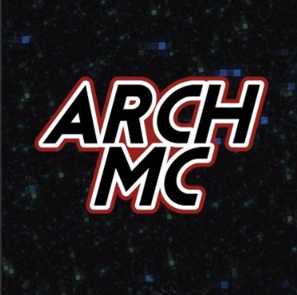

<div align="center">



# 🔎 ArchSearch

### Search everything about ArchMC in one place.

A fast, modern, and community-built search experience for ArchMC players.

<br>

[](https://heowoibleriemc.github.io/)
[](https://pages.github.com/)
[](#project-status)
[](LICENSE)

</div>

---

## 🌌 About ArchSearch

**ArchSearch** is an unofficial community search engine created for ArchMC players.

The goal is to make ArchMC information easier to find by bringing guides, commands, game tips, and useful resources into one clean and searchable website.

Instead of searching through multiple pages or asking the same questions repeatedly, players will be able to search ArchSearch and quickly find relevant information.

> ArchSearch is currently in active development. More content and features will be added over time.

---

## ✨ Features

- 🔎 Fast keyword search
- 🎮 ArchMC game mode guides
- ⚔️ PvP and Bedwars improvement tips
- 📚 Beginner-friendly explanations
- 💻 Responsive design for mobile, tablet, and desktop
- 🌙 Modern dark interface
- 🖼️ Official-style ArchMC visual design
- 🚀 Hosted with GitHub Pages
- 📢 ArchMC rank and website promotion area

---

## 🔍 Search Categories

ArchSearch is planned to include information about:

| Category | Content |
|---|---|
| Bedwars | Guides, strategies, leveling, and gameplay tips |
| Lifesteal | Survival, hearts, combat, and progression |
| Duels | Kits, movement, spacing, and PvP strategy |
| Housing | Building, plots, management, and visitors |
| Commands | Useful in-game commands and explanations |
| PvP | Aim, movement, sprint resetting, and decision-making |
| Beginners | Starting guides and basic server information |
| Ranks | ArchMC rank information and benefits |

---

## 🚀 Live Website

ArchSearch is available through GitHub Pages.

### [Open ArchSearch](https://heowoibleriemc.github.io/)

The website currently includes:

- ArchMC branding
- A responsive search interface
- Keyword-based result ranking
- Search result cards
- Mobile and iPad support

---

## 🖼️ Preview

<div align="center">


</div>

> Add `IMG_2886.png` to the repository if the preview image is not currently included.

---

## 🧠 How Search Works

ArchSearch searches through a local collection of ArchMC resources.

Each resource contains:

- A title
- A category
- A description
- Search keywords

Results receive a relevance score based on where the search term appears.

```text
Title match       +5 points
Category match    +4 points
Keyword match     +3 points
Description match +1 point
